# Architecture Overview

This document explains the technical structure of OpenRing Desktop v1.0. It
provides a high-level map of the main modules, their
responsibilities, and the data flow between the ring, protocol layer, storage,
UI, overlay and Gesture Hub.

## Architectural Goals

- separate BLE transport, protocol parsing, local storage and UI behavior
- keep protocol parsing deterministic and covered by automated tests
- route UI actions through dedicated controller, use-case and service layers
- keep the overlay integrated with the main app because the ring supports only
  one active BLE connection

## OpenRing Decomposition

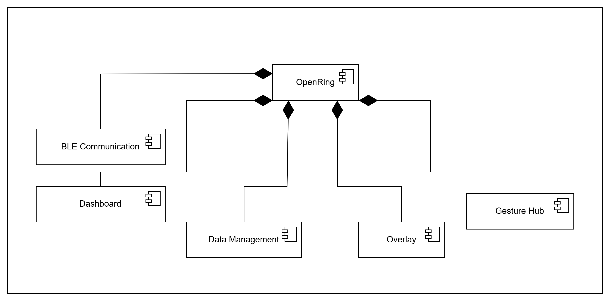

The decomposition shows OpenRing as a system made up of five components:

- **BLE Communication:** ring discovery, connection, packet transport and
  protocol processing.
- **Dashboard:** user interaction, live state, measurement control and Motion Lab.
- **Data Management:** local storage, history and data export.
- **Overlay:** compact live-data display and desktop window integration.
- **Gesture Hub:** translation of held ring positions into desktop controls.

## OpenRing Composition

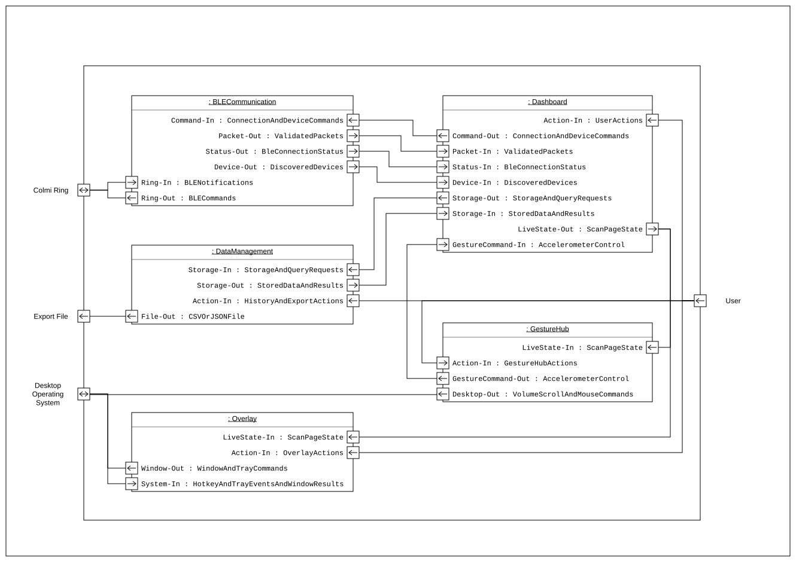

[Editable draw.io source](diagrams/composition.drawio)

The composition connects the five components through named ports. External
partners are the Colmi Ring, the User, the Desktop Operating System and the
Export File. Arrows inside the ports indicate flow direction; port labels
describe logical interactions.

## High-Level Flow

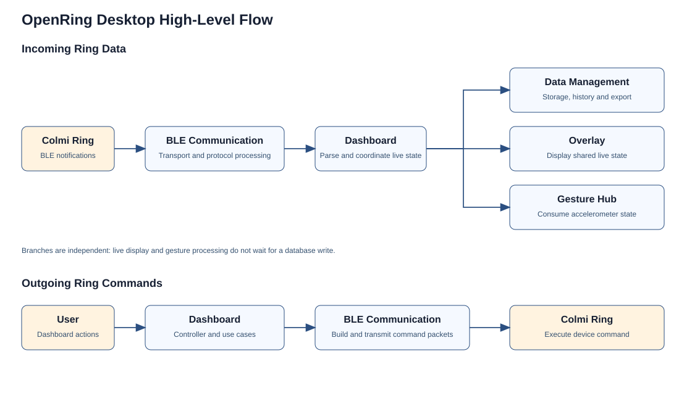

BLE Communication delivers validated packets to Dashboard, which invokes the
protocol parsers and updates shared state. Data Management receives persistence
requests, while Overlay and Gesture Hub consume shared state through Riverpod.
Displaying a live value does not wait for a database write.

Ring commands travel from Dashboard through `ScanPageUseCases`, protocol command
builders and `BleService` to the ring. The detailed packet, persistence and
history paths are documented in [data-flow.md](data-flow.md).

## Implementation Structure

### Shared State and External Libraries

Riverpod supplies shared dependencies and publishes controller state to widgets.
The libraries below support the five application components.

| External dependency | Responsibility in this application |
| --- | --- |
| Flutter, `flutter_riverpod` | Widgets, shared providers and reactive controller state |
| `universal_ble` | Platform scanning, connection, GATT discovery, writes and notifications |
| `drift`, `sqlite3_flutter_libs` | Typed database access and the native SQLite runtime |
| `path_provider`, `path` | Local database location and export paths |
| `window_manager` | Reconfigure the existing window for overlay mode |
| `system_tray`, `hotkey_manager` | Tray commands and global overlay/Gesture Hub shortcuts |
| `shared_preferences` | Persist overlay settings |
| `fl_chart` | History and motion charts |
| `file_selector` | Select an export destination |
| `drift_db_viewer` | Inspect the local database during development |

Dependencies are declared in [pubspec.yaml](../pubspec.yaml); resolved versions
are recorded in [pubspec.lock](../pubspec.lock).

### Principal Classes and Dependencies

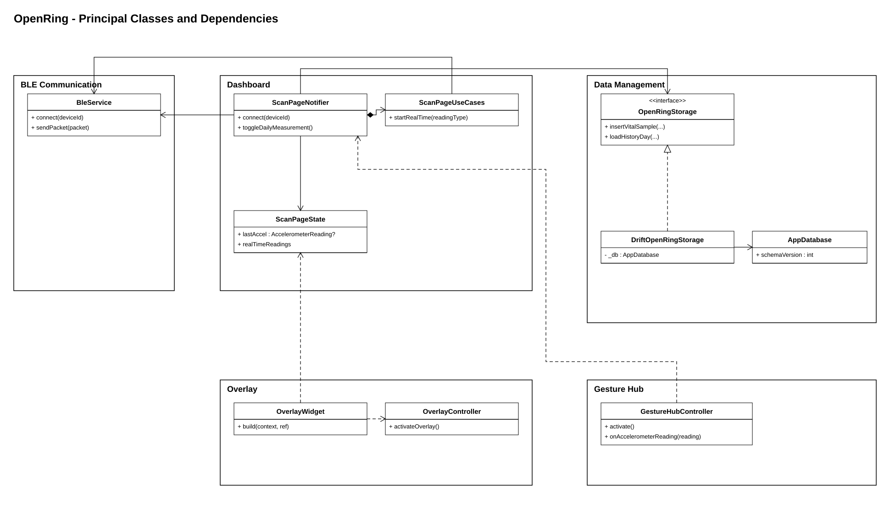

[Editable draw.io source (overview and five detail pages)](diagrams/classes.drawio)

#### Dashboard Classes

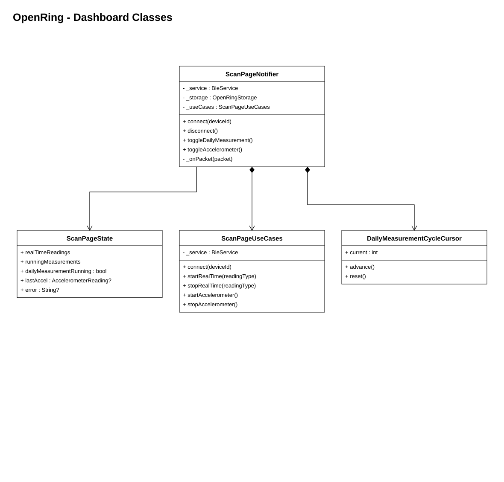

`ScanPageNotifier` coordinates connection handling, live state and measurements.
It delegates device commands to `ScanPageUseCases` and runs the daily measurement
cycle using `DailyMeasurementCycleCursor`.

#### BLE Communication Classes

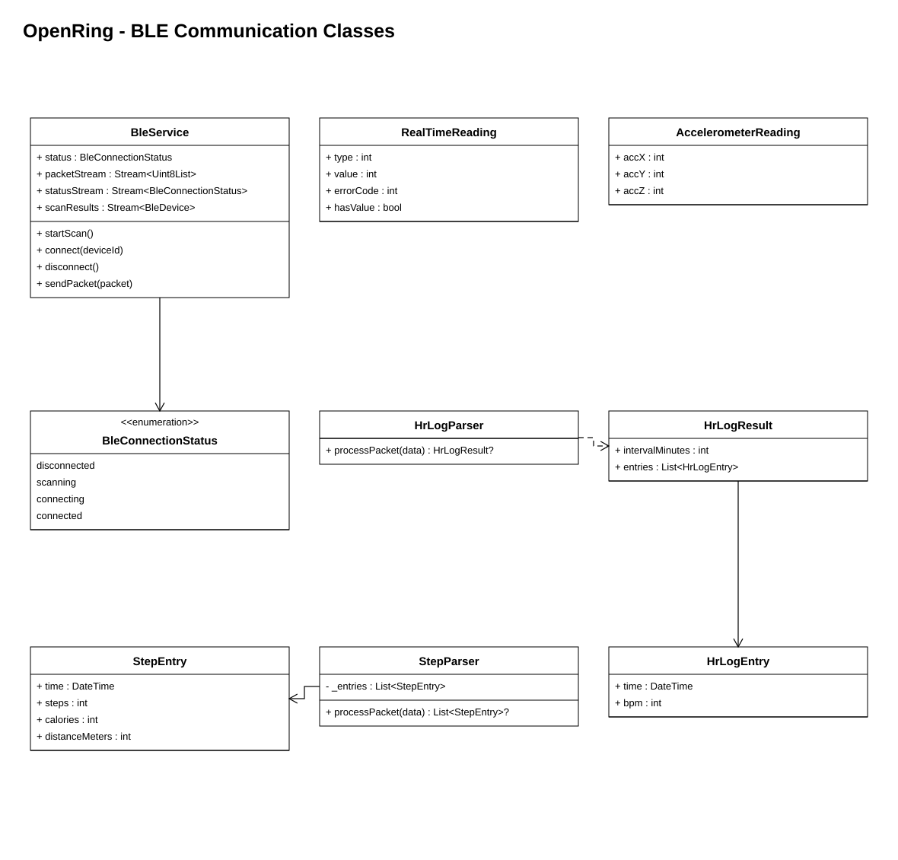

`BleService` provides validated packet bytes; `ScanPageNotifier` invokes the
protocol parsers. The log parsers assemble `HrLogResult` and `StepEntry` objects,
while top-level functions parse live and accelerometer readings. This is why
there are no direct associations from `BleService` to those parsers or models.

#### Data Management Classes

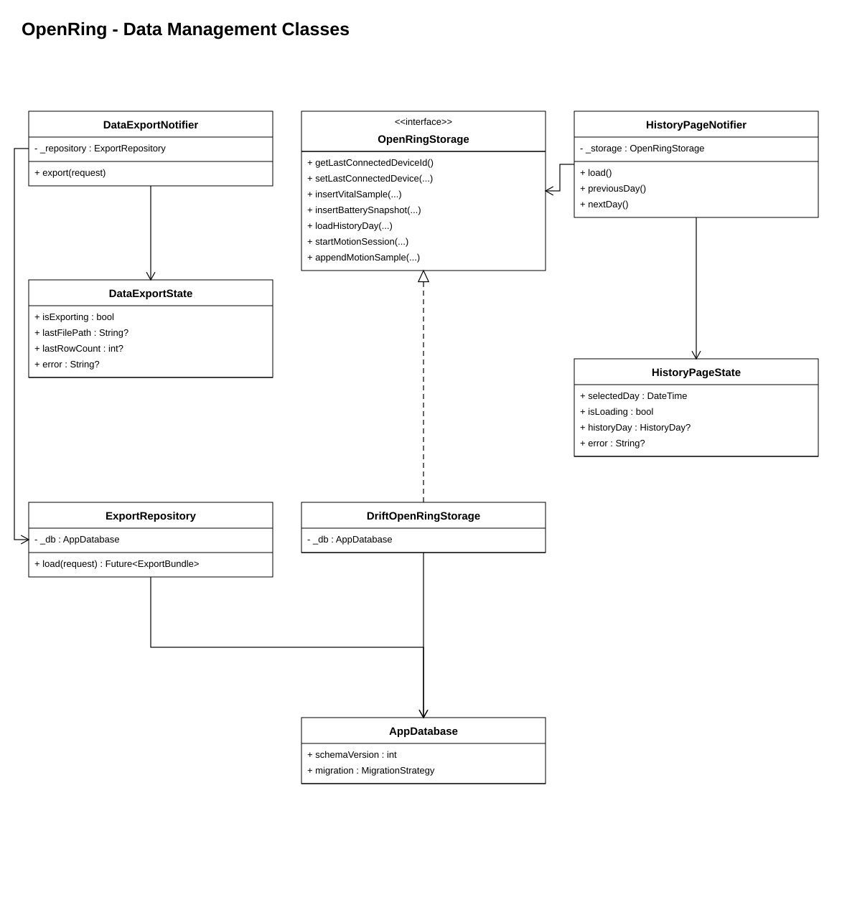

`DriftOpenRingStorage` implements the replaceable `OpenRingStorage` interface
and accesses `AppDatabase`. History uses this interface, while export queries
`AppDatabase` through its own `ExportRepository`.

#### Overlay Classes

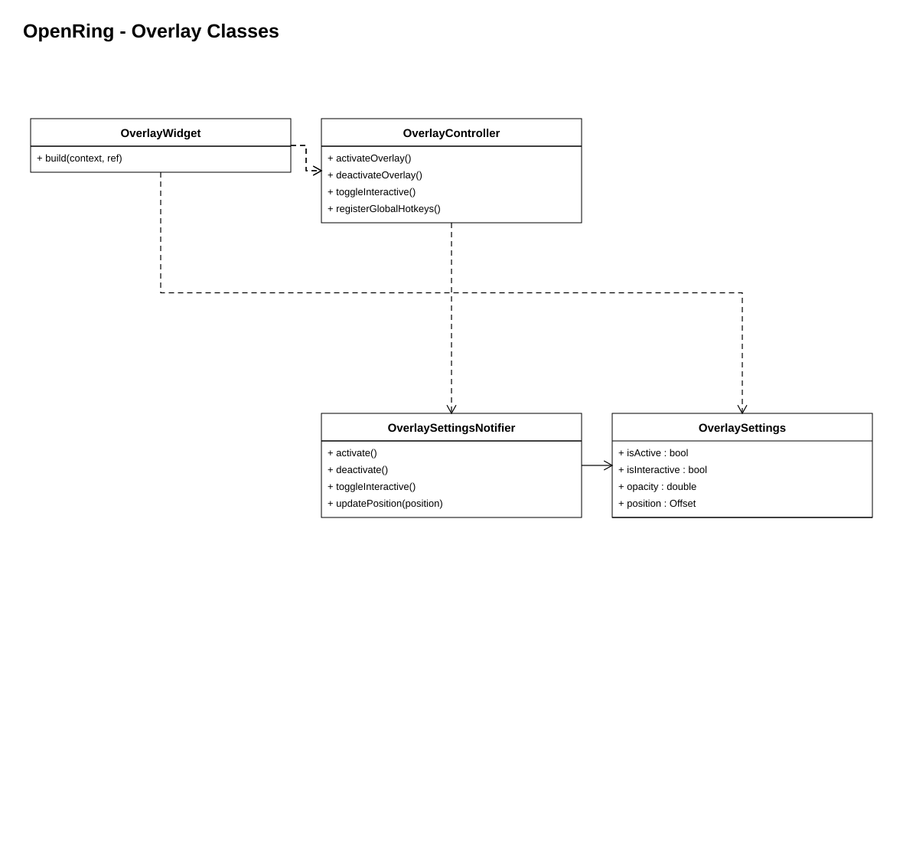

`OverlayWidget` reads live state and settings through Riverpod and delegates
window actions to `OverlayController`. The overlay reuses the application
window, providers and BLE connection.

#### Gesture Hub Classes

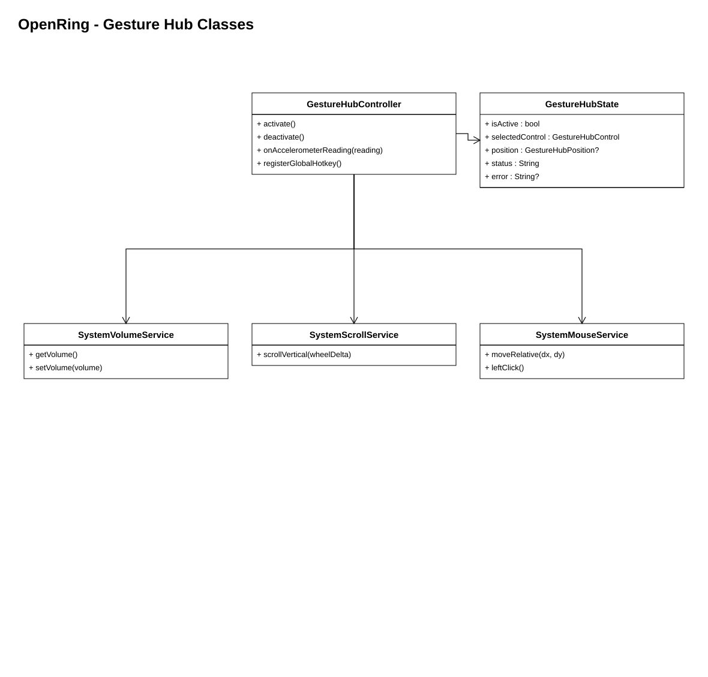

`GestureHubController` translates accelerometer readings into volume, scroll
and mouse actions. It controls the accelerometer through `ScanPageNotifier`;
the listener in `_ConnectedSectionShell` forwards incoming samples to it.

## Runtime Interaction and Failure Handling

### Connection and Incoming Data

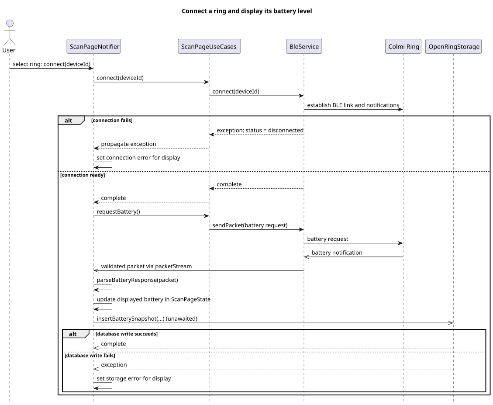

[PlantUML source](diagrams/connection-sequence.puml)

The sequence shows ring selection, connection, a battery request and the
asynchronous response. `ScanPageNotifier` parses the validated packet, updates
`ScanPageState` for display and starts an asynchronous database write.
Connection and storage failures illustrate the error paths; a storage failure
does not remove the already displayed battery value.

A completed BLE write does not guarantee a response, and this path has no
dedicated battery-response timeout. Packets with invalid length or checksum are
discarded before reaching the controller.

## Application States and Transitions

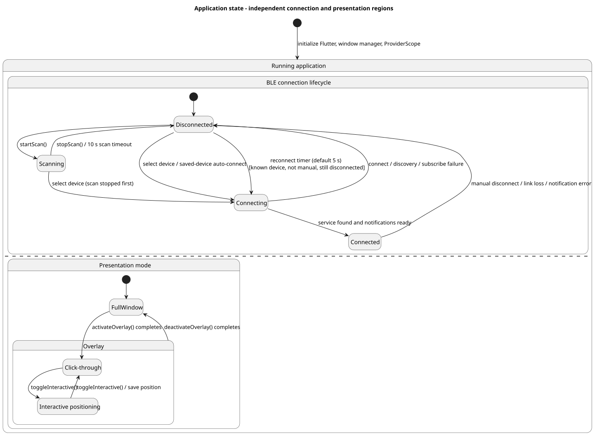

[PlantUML source](diagrams/app-states.puml)

The diagram shows two independent state regions: BLE connection status and
presentation mode, derived from `OverlaySettings.isActive` and `isInteractive`.
A reconnect resets measurement state and does not automatically resume the daily
cycle; measurement behavior is described in
[measurement-scheduling.md](measurement-scheduling.md).

Presentation transitions assume successful window operations; failures can leave
partially applied settings. Window behavior is detailed in [overlay.md](overlay.md).

## Code and Detailed Documentation

The architecture views above explain the system structure and collaboration.
Feature behavior, formats and validation details are maintained in the following
documents.

| Area | Main code | Detailed documentation |
| --- | --- | --- |
| BLE Communication | [ble/](../lib/src/ble/), [protocol/](../lib/src/protocol/) | [Protocol and packet formats](protocol.md) |
| Dashboard | [ui/](../lib/src/ui/), [measurements/](../lib/src/measurements/) | [Data paths](data-flow.md), [measurement scheduling](measurement-scheduling.md) |
| Data Management | [storage/](../lib/src/storage/), [history/](../lib/src/history/), [data_export/](../lib/src/data_export/) | [Database schema](database-schema.md), [history timestamp reconstruction](live-heart-rate-history.md), [history and storage flow](data-flow.md#history-flow) |
| Overlay | [overlay/](../lib/src/overlay/) | [Window behavior, settings and hotkeys](overlay.md) |
| Gesture Hub | [gesture_hub/](../lib/src/gesture_hub/) | [Gesture controls](gesture-hub.md), [Motion Lab and calibration](motion-research-lab.md) |
| Validation | [test/](../test/) | [Test strategy and commands](testing.md), [requirements test matrix](specs/requirements-test-matrix.md) |
