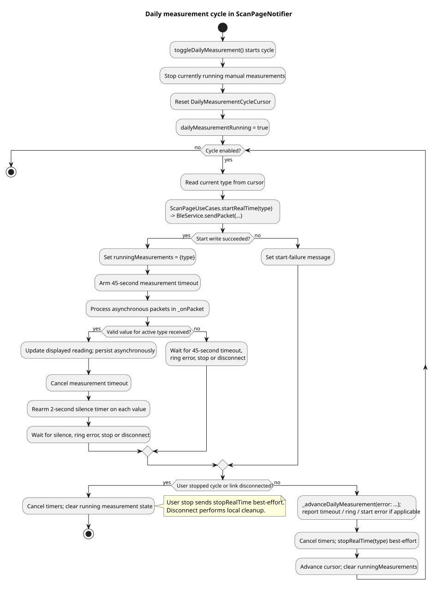

# Live Measurement Scheduling

Live heart rate, SpO2 and HRV measurements use the ring's optical sensor. These
measurements should not be treated as independent streams that can run in
parallel.

The app therefore runs live measurements one after another:

```text
start measurement -> collect valid values -> stop measurement -> next type
```

Only one real-time measurement should actively use the ring sensor at a time.

## Current Measurement Cycle

The current daily measurement cycle favors heart rate and checks HRV and SpO2
less often:

```text
HR -> HR -> HRV -> HR -> HR -> SpO2 -> HR -> HR -> HRV
```

This ratio is used because heart rate is expected to update more often, while
SpO2 and HRV can be sampled less frequently.

Battery and activity data are separate from this real-time optical measurement
cycle. They can be requested or synced independently.

## Daily Measurement Control Flow



[PlantUML source](diagrams/daily-measurement-activity.puml)

`ScanPageNotifier` stops running manual measurements before starting the daily
cycle and uses `DailyMeasurementCycleCursor` to select the next type. The
following rules govern each step:

| Event | Implemented reaction |
| --- | --- |
| Start command succeeds | Mark the type as running and arm a 45-second timeout. |
| Valid value for the active type arrives | Update the displayed value, persist asynchronously, cancel the measurement timeout and rearm a 2-second silence timer. |
| No further value arrives for 2 seconds | Attempt to stop the current type, advance the cursor and start the next type. |
| Start fails, ring reports an error, or the 45-second timeout expires | Report the error and advance to the next type after a best-effort stop. |
| User stops the cycle | Cancel timers, attempt to stop the active type and clear running state. |
| BLE disconnects | Cancel timers and clear live measurement state; reconnect does not automatically resume the cycle. |

The next daily measurement starts without an additional settle delay or error
backoff. A failed database write reports an error while the already displayed
live value remains visible.

## Manual Measurements and the Separate Scheduler

Manual measurements use a different path in `ScanPageNotifier`: a valid value
rearms a 3-second restart timer. After restarting, a new 45-second timeout waits
for a value; if no value arrives, the measurement stops with an error. Manual
toggles are ignored while the daily cycle is running.

`MeasurementScheduler` is a separate scheduling model with cooldown, error
backoff and freshness policies. It is tested independently but is not
instantiated by the current dashboard. Its policies must not be confused with
the daily cycle described above.

## Implementation Reference

| File | Purpose |
| --- | --- |
| [scan_page_controller.dart](../lib/src/ui/scan_page_controller.dart) | Active dashboard implementation of daily/manual measurement control, packet handling and timers |
| [daily_measurement_cycle.dart](../lib/src/measurements/daily_measurement_cycle.dart) | Fixed daily rotation and its cursor |
| [scan_page_use_cases.dart](../lib/src/ui/scan_page_use_cases.dart) | Start/stop commands delegated to BLE transport |
| [measurement_scheduler.dart](../lib/src/measurements/measurement_scheduler.dart) | Separate scheduling model; not used by the dashboard path |

Cycle and scheduler models have focused tests in
[test/measurements/](../test/measurements/); controller behavior is covered by
[scan_page_controller_test.dart](../test/ui/scan_page_controller_test.dart).
The overall system structure is described in [architecture.md](architecture.md).
